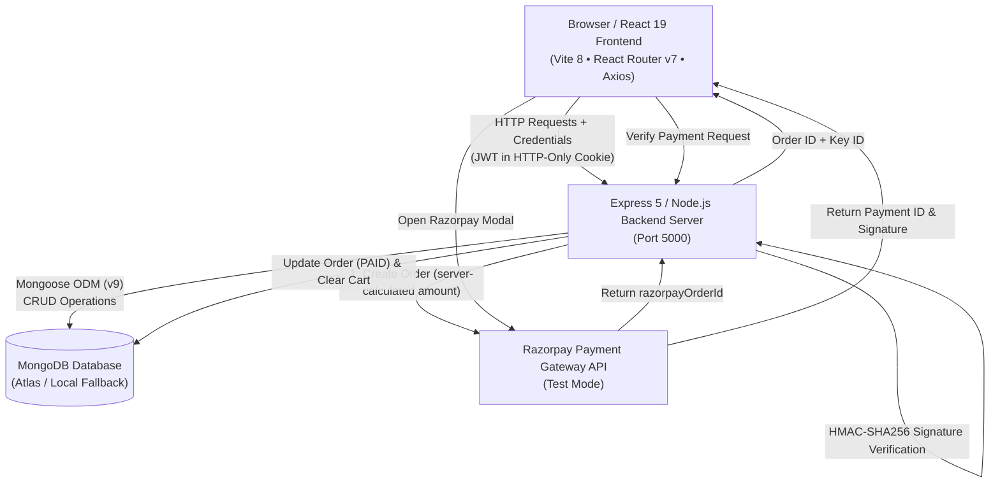
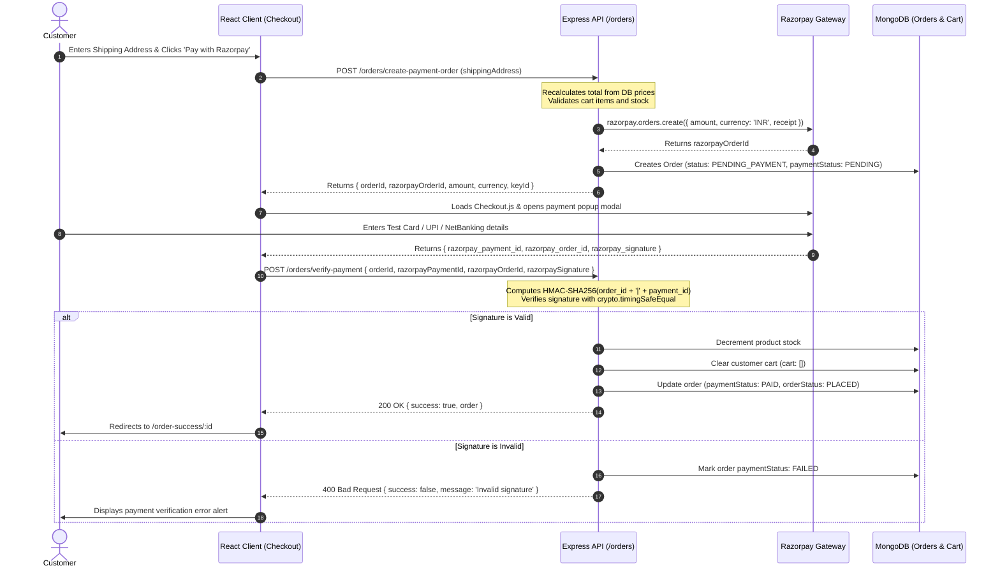

# 🛒 ShopKart — Modern MERN Stack E-Commerce Platform

[](https://react.dev)
[](https://react.dev)
[](https://expressjs.com)
[](https://mongoosejs.com)
[](https://razorpay.com)
[](https://opensource.org/licenses/ISC)

> **ShopKart** is a full-featured, production-ready MERN (MongoDB, Express, React, Node.js) e-commerce web platform engineered with security, performance, and user experience at its core. It incorporates full customer authentication via HTTP-only JWT cookies, dynamic product catalog discovery with live search and filtering, synchronized wishlist and persistent shopping cart states, and an end-to-end checkout pipeline powered by Razorpay Test Mode with server-side cryptographic HMAC-SHA256 signature verification.
>
> The user interface is crafted with a bespoke **Light Neumorphism** design system accented by vibrant cyan highlights (`#00C2CB` / `#0891B2`), soft layered elevation shadows, and micro-interactions built without bulky external UI libraries.

---

## 📑 Table of Contents

- [✨ Key Features by Domain](#-key-features-by-domain)
  - [🔐 Authentication & Customer Profile](#-authentication--customer-profile)
  - [🛍️ Product Catalog & Discovery](#️-product-catalog--discovery)
  - [💖 Wishlist System](#-wishlist-system)
  - [🛒 Shopping Cart](#-shopping-cart)
  - [💳 Checkout & Razorpay Payment Integration](#-checkout--razorpay-payment-integration)
  - [📦 Order History & Tracking](#-order-history--tracking)
- [🎨 Design System & UI/UX](#-design-system--uiux)
- [🏛️ Architecture & System Flow](#️-architecture--system-flow)
  - [High-Level Application Architecture](#high-level-application-architecture)
  - [Razorpay Two-Step Payment Verification Lifecycle](#razorpay-two-step-payment-verification-lifecycle)
- [💻 Tech Stack](#-tech-stack)
- [📁 Project Directory Structure](#-project-directory-structure)
- [🚀 Prerequisites & Getting Started](#-prerequisites--getting-started)
  - [Prerequisites](#prerequisites)
  - [Step-by-Step Installation (Windows PowerShell)](#step-by-step-installation-windows-powershell)
- [⚙️ Environment Configuration](#️-environment-configuration)
- [📡 Comprehensive API Reference](#-comprehensive-api-reference)
  - [Customer Endpoints (`/customers`)](#customer-endpoints-customers)
  - [Product Endpoints (`/products`)](#product-endpoints-products)
  - [Wishlist Endpoints (`/wishlist`)](#wishlist-endpoints-wishlist)
  - [Cart Endpoints (`/cart`)](#cart-endpoints-cart)
  - [Order & Checkout Endpoints (`/orders`)](#order--checkout-endpoints-orders)
- [🗄️ Database Models & Schemas](#️-database-models--schemas)
  - [Customer Model (`Customer`)](#customer-model-customer)
  - [Product Model (`Product`)](#product-model-product)
  - [Order Model (`Order`)](#order-model-order)
- [🔒 Payment Security & Data Integrity](#-payment-security--data-integrity)
- [🧪 Testing & Quality Assurance](#-testing--quality-assurance)
- [🛠️ Troubleshooting & FAQ](#️-troubleshooting--faq)
- [📚 Engineering Labs (Labs 01–06) Breakdown](#-engineering-labs-labs-0106-breakdown)
- [🔮 Future Roadmap](#-future-roadmap)
- [📄 License](#-license)

---

## ✨ Key Features by Domain

### 🔐 Authentication & Customer Profile

- **Secure Registration & Login**: Validates full name, email, phone number, and minimum 6-character passwords.
- **Bcrypt Password Hashing**: Passwords salted and hashed with 10 salt rounds prior to persistence.
- **HTTP-Only Cookie Transport**: JWT tokens are transmitted exclusively via `httpOnly: true`, `sameSite: 'strict'` cookies, mitigating cross-site scripting (XSS) token exfiltration vulnerabilities.
- **Session Introspection**: Real-time customer state validation via `GET /customers/me` on client startup and protected page transitions.
- **Graceful Logout**: Securely clears the session cookie and purges client-side cart/wishlist stores.

### 🛍️ Product Catalog & Discovery

- **Responsive Product Grid**: Neumorphic product cards featuring high-res imagery, badges, categories, and real-time stock counters.
- **Real-Time Keyword Search**: Case-insensitive search filtering across product titles and descriptions.
- **Dynamic Category Filtering**: Category chips allowing single-click filtering (`All`, `Electronics`, `Footwear`, `Accessories`, etc.).
- **Price Sorting**: Bidirectional sorting supported directly via query parameters (`price_asc` and `price_desc`).
- **Product Details Page (`/products/:id`)**: Comprehensive view showing detailed descriptions, price tags, category metadata, real-time stock status (`In Stock` vs `Out of Stock`), and instant Add to Cart / Wishlist controls.

### 💖 Wishlist System

- **Single-Click Toggle**: Add or remove products directly from product cards or the product details page.
- **Synchronized Header Counter**: Real-time badge counter in the top navigation bar powered by React `WishlistContext`.
- **Dedicated Wishlist View (`/wishlist`)**: Populated product grid with quick-access "Move to Cart" action and deletion triggers.
- **Zero Duplicates**: Server-side duplicate validation (`409 Conflict`) and populated product references.

### 🛒 Shopping Cart

- **Persistent Storage**: Cart items and quantities are directly attached to the customer document in MongoDB.
- **Stock-Aware Quantity Controls**: In-place quantity increments (`+`) and decrements (`-`) strictly capped between `1` and the product's available inventory.
- **Live Summary Recalculation**: Subtotal, taxes/shipping calculations, and grand total recalculate dynamically on each operation.
- **Immediate Item Removal**: Fast item deletion with instant badge decrement across the entire application.

### 💳 Checkout & Razorpay Payment Integration

- **Validated Shipping Capture**: Dedicated checkout form validating full name, 10-digit phone number, street address, city, state, and 6-digit Indian PIN code.
- **Two-Step Secure Checkout**:
  1. _Step 1_: Backend recalculates exact cart subtotal from database prices and issues an authenticated Razorpay Order via the official Razorpay SDK.
  2. _Step 2_: Client initializes Razorpay Checkout modal; upon successful authorization, client submits payment identifiers back to Express.
- **Cryptographic Verification**: Backend constructs HMAC-SHA256 digest of `${razorpayOrderId}|${razorpayPaymentId}` with `RAZORPAY_KEY_SECRET` and verifies it using `crypto.timingSafeEqual` to eliminate timing attacks.
- **Atomic Order Placement**: Upon verified payment, stock counts are decremented, cart is cleared, and order transitions to `PLACED` status.
- **Confirmation View (`/order-success/:id`)**: Visual confirmation with Razorpay transaction reference, order ID, and shipping summary.

### 📦 Order History & Tracking

- **Chronological Orders Dashboard (`/orders`)**: List of past orders with timestamps, status tags, item count, and total amount.
- **Itemized Order Details (`/orders/:id`)**: Complete purchase history with historical price and name snapshots, shipping address details, and Razorpay transaction IDs (`razorpayOrderId`, `razorpayPaymentId`).
- **Visual Status Badges**:
  - Payment: `PAID`, `PENDING`, `FAILED`
  - Order: `PLACED`, `PENDING_PAYMENT`, `CANCELLED`, `DELIVERED`

---

## 🎨 Design System & UI/UX

ShopKart uses a **Light Neumorphism** visual theme with **Cyan Accents**:

- **Color Palette**:
  - **Background**: Soft off-white / silver-gray (`#EEF2F5`)
  - **Primary Accent**: Cyan (`#00C2CB` / `#0891B2`)
  - **Secondary Accent**: Royal Blue (`#3B82F6`)
  - **Text Colors**: Deep slate (`#1E293B`) and muted steel (`#64748B`)
  - **Status Accents**: Emerald green (`#10B981`) for `In Stock` / `PAID` and crimson (`#EF4444`) for `Out of Stock` / `FAILED`.
- **Neumorphic Elevation Principles**:
  - **Raised Elements** (Cards, Buttons, Inputs): Dual drop-shadow (`-6px -6px 14px #FFFFFF, 6px 6px 14px rgba(163, 177, 198, 0.45)`)
  - **Pressed / Inset Elements** (Active States, Form Inputs on Focus): Inset drop-shadow (`inset 3px 3px 6px rgba(163, 177, 198, 0.4), inset -3px -3px 6px #FFFFFF`)
- **Zero Third-Party CSS Frameworks**: Built using pure, modern CSS with CSS variables, flexbox, and CSS grid for fast load times and clean bundle size.

---

## 🏛️ Architecture & System Flow

### High-Level Application Architecture



---

### Razorpay Two-Step Payment Verification Lifecycle



---

## 💻 Tech Stack

| Layer                       | Technology                                                                | Version     | Purpose                                                                              |
| :-------------------------- | :------------------------------------------------------------------------ | :---------- | :----------------------------------------------------------------------------------- |
| **Frontend Framework**      | [React](https://react.dev/)                                               | `^19.2.8`   | Component-based interactive UI with React Hooks & StrictMode                         |
| **Frontend Build Tool**     | [Vite](https://vitejs.dev/)                                               | `^8.3.0`    | Ultra-fast development server and optimized production bundler                       |
| **Client Routing**          | [React Router](https://reactrouter.com/)                                  | `^7.18.4`   | Client-side routing, protected routes, and URL parameter handling                    |
| **HTTP Client**             | [Axios](https://axios-http.com/)                                          | `^1.20.0`   | Promise-based HTTP client with credentialed cookie sharing (`withCredentials: true`) |
| **Styling**                 | Pure CSS3 / Custom Neumorphism                                            | —           | Soft-shadow UI system with responsive CSS Grid and Flexbox                           |
| **Backend Runtime**         | [Node.js](https://nodejs.org/)                                            | `>= 18.0.0` | Server-side JavaScript runtime (CommonJS module system)                              |
| **Web Server Framework**    | [Express](https://expressjs.com/)                                         | `^5.2.1`    | REST API routing, JSON body parsing, and middleware chain                            |
| **Database & ODM**          | [MongoDB](https://www.mongodb.com/) / [Mongoose](https://mongoosejs.com/) | `^9.10.1`   | NoSQL document database with strict schema modeling & population                     |
| **Authentication & Tokens** | [JSON Web Token (JWT)](https://jwt.io/)                                   | `^9.0.3`    | Cryptographically signed identity tokens (7-day validity)                            |
| **Password Security**       | [Bcrypt](https://github.com/kelektiv/node.bcrypt.js)                      | `^6.0.0`    | Adaptive salted password hashing (10 salt rounds)                                    |
| **Cookie Parsing**          | [Cookie-Parser](https://github.com/expressjs/cookie-parser)               | `^1.4.7`    | Secure extraction of signed HTTP-only cookies                                        |
| **CORS Middleware**         | [CORS](https://github.com/expressjs/cors)                                 | `^2.8.6`    | Cross-Origin Resource Sharing with whitelisted credentials origin                    |
| **Payment Gateway**         | [Razorpay Node SDK](https://github.com/razorpay/razorpay-node)            | `^2.9.8`    | Server-side payment order initialization & Checkout.js client integration            |
| **Code Linting**            | [Oxlint](https://oxc.rs/)                                                 | `^1.81.0`   | High-performance Rust-based JavaScript and React linter                              |

---

## 📁 Project Directory Structure

```text
Shop-Kart/
├── backend/
│   ├── controllers/
│   │   ├── cart.controller.js          # Cart CRUD, quantity adjustment & stock caps
│   │   ├── customer.controller.js      # Register, login, getMe, logout
│   │   ├── order.controller.js         # Razorpay order generation & signature verification
│   │   ├── product.controller.js       # Product creation, listing, search, sort, getById
│   │   └── wishlist.controller.js      # Wishlist toggle, population & removal
│   ├── middlewares/
│   │   └── auth.middleware.js          # JWT verification via HTTP cookies (req.user)
│   ├── models/
│   │   ├── customer.model.js           # Customer schema with embedded cart & wishlist
│   │   ├── order.model.js              # Order schema with snapshot items & shipping
│   │   └── product.model.js            # Product schema with price & stock validations
│   ├── routes/
│   │   ├── cart.routes.js              # /cart endpoints
│   │   ├── customer.routes.js          # /customers endpoints
│   │   ├── order.routes.js             # /orders endpoints
│   │   ├── product.routes.js           # /products endpoints
│   │   └── wishlist.routes.js          # /wishlist endpoints
│   ├── utils/
│   │   └── generateToken.js            # JWT generator utility (7-day expiry)
│   ├── .env.example                    # Environment variable template
│   ├── .gitignore                      # Backend ignore list (node_modules, .env)
│   ├── index.js                        # Express server entry point, DNS setup & DB connect
│   ├── package.json                    # Backend dependencies & start script
│   └── package-lock.json
│
├── frontend/
│   ├── public/
│   │   ├── favicon.svg                 # Application favicon
│   │   └── icons.svg
│   ├── src/
│   │   ├── assets/
│   │   │   └── hero.png                # Hero section marketing artwork
│   │   ├── components/
│   │   │   ├── CartItem.jsx            # Quantity controls, subtotal & removal UI
│   │   │   ├── Navbar.jsx              # Responsive header with dynamic counters
│   │   │   ├── ProductCard.jsx         # Card with stock status, wishlist & cart triggers
│   │   │   └── WishlistCard.jsx        # Populated wishlist item with Move-to-Cart
│   │   ├── context/
│   │   │   ├── CartContext.jsx         # Global cart state, item count & totals
│   │   │   └── WishlistContext.jsx     # Global wishlist state & toggle management
│   │   ├── pages/
│   │   │   ├── Cart.jsx                # Shopping cart page with order breakdown
│   │   │   ├── Checkout.jsx            # Shipping form & Razorpay Checkout integration
│   │   │   ├── Home.jsx                # Landing page with hero banner & featured items
│   │   │   ├── Login.jsx               # Customer login form
│   │   │   ├── OrderDetails.jsx        # Detailed order view with item snapshots
│   │   │   ├── Orders.jsx              # Order history dashboard
│   │   │   ├── OrderSuccess.jsx        # Payment confirmation page
│   │   │   ├── ProductDetails.jsx      # Deep-dive product specification page
│   │   │   ├── Products.jsx            # Catalog with live search, filters & sort
│   │   │   ├── Register.jsx            # New customer onboarding form
│   │   │   └── Wishlist.jsx            # Wishlist overview page
│   │   ├── services/
│   │   │   └── api.js                  # Axios client configured with withCredentials: true
│   │   ├── App.css
│   │   ├── App.jsx                     # Route registry (React Router v7)
│   │   ├── index.css                   # Global Light Neumorphism styles & variables
│   │   └── main.jsx                    # Application root & Context Provider tree
│   ├── index.html                      # HTML entry with viewport & fonts
│   ├── package.json                    # Frontend dependencies & build/lint scripts
│   ├── vite.config.js                  # Vite configuration with React plugin
│   └── .oxlintrc.json                  # Oxlint configuration
│
├── .gitignore                          # Root ignore rules for node_modules, dist, .env
└── README.md                           # Master Project Documentation
```

---

## 🚀 Prerequisites & Getting Started

### Prerequisites

Ensure you have the following installed on your workstation:

- **Node.js**: `v18.0.0` or higher ([Download Node.js](https://nodejs.org/))
- **npm**: `v9.0.0` or higher
- **MongoDB**: A running local MongoDB instance (`mongodb://127.0.0.1:27017`) or a free [MongoDB Atlas Cluster](https://www.mongodb.com/atlas)
- **Razorpay Account**: Free Razorpay account in **Test Mode** ([Razorpay Dashboard](https://dashboard.razorpay.com/)) to obtain API Key ID and Key Secret.

---

### Step-by-Step Installation (Windows PowerShell)

#### 1. Clone or Open the Repository

```powershell
# Navigate into the project root directory
cd "c:\Users\Mallesh\OneDrive\Desktop\MERN- Projects\Shop-Kart"
```

#### 2. Configure Backend Server

```powershell
# Change directory to backend
cd backend

# Install backend dependencies
npm install

# Create environment configuration file from template
Copy-Item .env.example .env
```

Open `backend/.env` in your code editor and populate your real MongoDB URI and Razorpay Test credentials:

```env
PORT=5000
mongodb+srv://<username>:<password>@<cluster-url>/<database>
JWT_SECRET=your_super_secret_jwt_key_here_minimum_32_characters
RAZORPAY_KEY_ID=rzp_test_yourKeyIdHere
RAZORPAY_KEY_SECRET=yourKeySecretHere
```

> **Automatic Database Fallback**: The backend includes an automated fallback mechanism in `backend/index.js`. If your cloud MongoDB Atlas connection times out or encounters network/DNS restrictions, it automatically routes to your local MongoDB server at `mongodb://127.0.0.1:27017/shopkart`.

```powershell
# Start the backend API server
npm start
```

_Expected terminal output:_

```text
MongoDB connected
Server running on port 5000
```

#### 3. Configure Frontend Client

Open a new PowerShell terminal:

```powershell
# Navigate to the frontend directory
cd "c:\Users\Mallesh\OneDrive\Desktop\MERN- Projects\Shop-Kart\frontend"

# Install frontend dependencies
npm install

# Start Vite development server
npm run dev
```

_Expected terminal output:_

```text
  VITE v8.3.0  ready in 180 ms

  ➜  Local:   http://localhost:5173/
  ➜  Network: use --host to expose
```

#### 4. Access the Application

Open your browser and navigate to:

```text
http://localhost:5173
```

You will be greeted with the ShopKart portal, redirected to `/login` if unauthenticated.

---

## ⚙️ Environment Configuration

The backend requires the following environment variables configured in `backend/.env`:

| Variable | Description                       |      Required       | Example |
| :------- | :-------------------------------- | :-----------------: | :------ |
| `PORT`   | Local port for Express API server | No (default `5000`) | `5000`  |

mongodb+srv://<username>:<password>@<cluster-url>/<database>
| `JWT_SECRET` | Secret string used to sign and verify JSON Web Tokens | **Yes** | `super_secret_jwt_random_hash_string` |
| `RAZORPAY_KEY_ID` | Razorpay Test Mode Key ID (starts with `rzp_test_`) | **Yes** | `rzp_test_AbCdEf123456` |
| `RAZORPAY_KEY_SECRET` | Razorpay Test Mode Key Secret | **Yes** | `xYz9876543210ABCDEF` |

> 🔒 **Security Notice**: Never commit `backend/.env` to source control. It is strictly excluded in `.gitignore`. Use `backend/.env.example` as a template for new deployments.

---

## 📡 Comprehensive API Reference

All requests and responses use JSON (`Content-Type: application/json`). Protected routes require the `token` cookie set by login or registration.

### Customer Endpoints (`/customers`)

| Method | Endpoint              | Access    | Description                        | Request Body                           | Success Response                                | Error Codes         |
| :----- | :-------------------- | :-------- | :--------------------------------- | :------------------------------------- | :---------------------------------------------- | :------------------ |
| `POST` | `/customers/register` | Public    | Register new customer              | `{ fullName, email, password, phone }` | `201 Created`<br/>`{ success: true, customer }` | `400`, `409`, `500` |
| `POST` | `/customers/login`    | Public    | Authenticate customer & set cookie | `{ email, password }`                  | `200 OK`<br/>`{ success: true, customer }`      | `400`, `401`, `500` |
| `GET`  | `/customers/me`       | Protected | Get authenticated profile          | _None_                                 | `200 OK`<br/>`{ success: true, customer }`      | `401`, `500`        |
| `POST` | `/customers/logout`   | Protected | Clear JWT cookie session           | _None_                                 | `200 OK`<br/>`{ success: true, message }`       | `500`               |

---

### Product Endpoints (`/products`)

| Method | Endpoint        | Access | Query Parameters                                           | Request Body                                           | Success Response                                  | Error Codes         |
| :----- | :-------------- | :----- | :--------------------------------------------------------- | :----------------------------------------------------- | :------------------------------------------------ | :------------------ |
| `POST` | `/products`     | Public | —                                                          | `{ name, description, price, category, image, stock }` | `201 Created`<br/>`{ success: true, product }`    | `400`, `500`        |
| `GET`  | `/products`     | Public | `search`, `category`, `sort` (`price_asc` \| `price_desc`) | _None_                                                 | `200 OK`<br/>`{ success: true, count, products }` | `500`               |
| `GET`  | `/products/:id` | Public | —                                                          | _None_                                                 | `200 OK`<br/>`{ success: true, product }`         | `400`, `404`, `500` |

---

### Wishlist Endpoints (`/wishlist`)

| Method   | Endpoint               | Access    | Description                      | Success Response                                  | Error Codes                       |
| :------- | :--------------------- | :-------- | :------------------------------- | :------------------------------------------------ | :-------------------------------- |
| `POST`   | `/wishlist/:productId` | Protected | Add product to customer wishlist | `200 OK`<br/>`{ success: true, message }`         | `400`, `401`, `404`, `409`, `500` |
| `GET`    | `/wishlist`            | Protected | Get all populated wishlist items | `200 OK`<br/>`{ success: true, count, wishlist }` | `401`, `500`                      |
| `DELETE` | `/wishlist/:productId` | Protected | Remove item from wishlist        | `200 OK`<br/>`{ success: true, message }`         | `400`, `401`, `404`, `500`        |

---

### Cart Endpoints (`/cart`)

| Method   | Endpoint           | Access    | Description                                   | Request Body      | Success Response                       | Error Codes                |
| :------- | :----------------- | :-------- | :-------------------------------------------- | :---------------- | :------------------------------------- | :------------------------- |
| `POST`   | `/cart/:productId` | Protected | Add product to cart (increments if exists)    | _None_            | `200 OK`<br/>`{ success: true, cart }` | `400`, `401`, `404`, `500` |
| `GET`    | `/cart`            | Protected | Fetch populated cart items                    | _None_            | `200 OK`<br/>`{ success: true, cart }` | `401`, `500`               |
| `PATCH`  | `/cart/:productId` | Protected | Set specific item quantity (checks stock cap) | `{ quantity: 3 }` | `200 OK`<br/>`{ success: true, cart }` | `400`, `401`, `404`, `500` |
| `DELETE` | `/cart/:productId` | Protected | Remove item from customer cart                | _None_            | `200 OK`<br/>`{ success: true, cart }` | `400`, `401`, `404`, `500` |

---

### Order & Checkout Endpoints (`/orders`)

| Method | Endpoint                       | Access    | Description                                                     | Request Body                                                                  | Success Response                                                                         | Error Codes                       |
| :----- | :----------------------------- | :-------- | :-------------------------------------------------------------- | :---------------------------------------------------------------------------- | :--------------------------------------------------------------------------------------- | :-------------------------------- |
| `POST` | `/orders/create-payment-order` | Protected | Validate cart, recalculate subtotal, issue Razorpay order       | `{ shippingAddress: { fullName, phone, addressLine, city, state, pincode } }` | `201 Created`<br/>`{ success: true, orderId, razorpayOrderId, amount, currency, keyId }` | `400`, `401`, `500`, `502`        |
| `POST` | `/orders/verify-payment`       | Protected | Cryptographically verify HMAC-SHA256 signature & finalize order | `{ orderId, razorpayOrderId, razorpayPaymentId, razorpaySignature }`          | `200 OK`<br/>`{ success: true, message, order }`                                         | `400`, `401`, `403`, `404`, `500` |
| `GET`  | `/orders`                      | Protected | Fetch customer order history (newest first)                     | _None_                                                                        | `200 OK`<br/>`{ success: true, count, orders }`                                          | `401`, `500`                      |
| `GET`  | `/orders/:id`                  | Protected | Fetch specific order details (owner-restricted)                 | _None_                                                                        | `200 OK`<br/>`{ success: true, order }`                                                  | `400`, `401`, `404`, `500`        |

---

## 🗄️ Database Models & Schemas

### Customer Model (`Customer`)

```javascript
{
  fullName:  { type: String, required: true, trim: true },
  email:     { type: String, required: true, unique: true, lowercase: true, trim: true },
  password:  { type: String, required: true }, // 10-round bcrypt hash
  phone:     { type: String, required: true, trim: true },
  wishlist:  [{ type: mongoose.Schema.Types.ObjectId, ref: 'Product' }],
  cart: [{
    product:  { type: mongoose.Schema.Types.ObjectId, ref: 'Product', required: true },
    quantity: { type: Number, default: 1, min: [1, 'Quantity must be at least 1'] }
  }],
  createdAt: { type: Date, default: Date.now }
}
```

### Product Model (`Product`)

```javascript
{
  name:        { type: String, required: true, trim: true },
  description: { type: String, required: true },
  price:       { type: Number, required: true, min: [0.01, 'Price must be greater than 0'] },
  category:    { type: String, required: true, trim: true },
  image:       { type: String, required: true, trim: true },
  stock:       { type: Number, required: true, min: [0, 'Stock cannot be negative'] },
  createdAt:   { type: Date, default: Date.now }
}
```

### Order Model (`Order`)

```javascript
{
  customer: { type: mongoose.Schema.Types.ObjectId, ref: 'Customer', required: true },
  items: [{
    product:  { type: mongoose.Schema.Types.ObjectId, ref: 'Product', required: true },
    name:     { type: String, required: true, trim: true },     // Snapshot at purchase time
    price:    { type: Number, required: true, min: 0 },          // Snapshot at purchase time
    quantity: { type: Number, required: true, min: 1 },
    image:    { type: String, trim: true, default: '' }
  }],
  shippingAddress: {
    fullName:    { type: String, required: true, trim: true },
    phone:       { type: String, required: true, trim: true },
    addressLine: { type: String, required: true, trim: true },
    city:        { type: String, required: true, trim: true },
    state:       { type: String, required: true, trim: true },
    pincode:     { type: String, required: true, trim: true }
  },
  totalAmount:       { type: Number, required: true, min: 0 },
  paymentStatus:     { type: String, enum: ['PENDING', 'PAID', 'FAILED'], default: 'PENDING' },
  orderStatus:       { type: String, enum: ['PENDING_PAYMENT', 'PLACED', 'CANCELLED', 'DELIVERED'], default: 'PENDING_PAYMENT' },
  razorpayOrderId:   { type: String, trim: true, default: '' },
  razorpayPaymentId: { type: String, trim: true, default: '' },
  razorpaySignature: { type: String, trim: true, default: '' },
  createdAt:         { type: Date, default: Date.now }
}
```

---

## 🔒 Payment Security & Data Integrity

ShopKart strictly enforces financial and architectural security protocols during payment and checkout:

1. **Client Prices Are Never Trusted**:
   - The frontend never submits the payable total amount to the server.
   - During `POST /orders/create-payment-order`, the server populates each cart item's current price directly from the MongoDB `Product` collection and sums `price * quantity`.
   - The total is converted to the smallest currency unit (paise: `Math.round(totalAmount * 100)`) before generating the order with Razorpay.

2. **Cryptographic HMAC-SHA256 Signature Verification**:
   - Upon completion of the Razorpay modal checkout, the client receives `razorpay_order_id`, `razorpay_payment_id`, and `razorpay_signature`.
   - The server verifies the signature by generating an HMAC-SHA256 digest:
     ```javascript
     const textToSign = `${razorpayOrderId}|${razorpayPaymentId}`;
     const generatedSignature = crypto
       .createHmac("sha256", process.env.RAZORPAY_KEY_SECRET)
       .update(textToSign)
       .digest("hex");
     ```
   - Both strings are converted into byte buffers and compared using **`crypto.timingSafeEqual`**, completely preventing byte-by-byte timing discrepancy attacks.

3. **Idempotent Verification**:
   - If a duplicate payment verification webhook or client retry occurs for an order that is already marked `PAID`, the controller returns `200 OK` idempotently without double-decrementing stock or throwing duplicate database writes.

4. **Purchase-Time Historical Snapshots**:
   - Product titles, images, and prices are permanently captured as snapshot values inside `order.items`.
   - If an admin edits catalog prices or descriptions in the future, all past order records remain 100% historically and legally accurate.

5. **Atomic Stock & Cart Cleanup**:
   - Decrementing product stock (`$inc: { stock: -quantity }`) and clearing the customer's cart (`cart: []`) occur **only after** the HMAC signature is cryptographically validated.

---

## 🧪 Testing & Quality Assurance

### Frontend Production Build

Verify bundle compilation and tree-shaking with Vite:

```powershell
cd frontend
npm run build
```

_Result:_

```text
✓ 97 modules transformed.
dist/index.html                   0.45 kB │ gzip:   0.29 kB
dist/assets/index.css            42.33 kB │ gzip:   6.77 kB
dist/assets/index.js            369.00 kB │ gzip: 112.68 kB
✓ built in ~300ms
```

### Static Analysis & Linting

Run Oxlint across all 21 frontend components and context providers:

```powershell
cd frontend
npm run lint
```

_Result:_ `0 errors`, passing on all JSX and JS files.

### Automated Regression Testing

ShopKart includes comprehensive verification suites testing the entire platform lifecycle:

- **Suite 1: Labs 01–05 Audit**: 41 passed assertions verifying Customer Auth, Token Cookies, Product Filters, Wishlist Toggles, and Cart Caps.
- **Suite 2: Lab 06 & Payment Regression**: 28 passed assertions validating Shipping Validation, Razorpay Order Generation, HMAC-SHA256 Signature Verification, Invalid Signature Rejection, Stock Decrementing, Cart Clearing, and Order History retrieval.
- **Total Test Coverage**: **69 / 69 passing assertions (100% Pass Rate)**.

---

## 🛠️ Troubleshooting & FAQ

### 1. MongoDB Atlas Connection Timeout (`querySrv ECONNREFUSED`)

- **Cause**: Certain local ISPs, firewalls, or custom DNS resolvers block DNS SRV lookups on MongoDB Atlas cluster addresses.
- **Solution**: The backend automatically sets DNS servers to Cloudflare (`1.1.1.1`) and Google (`8.8.8.8`) at the very top of `backend/index.js`. Additionally, if Atlas connection fails after 3000ms, it gracefully falls back to your local MongoDB instance (`mongodb://127.0.0.1:27017/shopkart`).

### 2. Cookie or CORS Issues in Browser (`401 Unauthorized` on `/me`)

- **Cause**: Cookies are not transmitted if frontend and backend origins do not match CORS rules or if `withCredentials` is disabled.
- **Solution**:
  - Backend is configured with `cors({ origin: 'http://localhost:5173', credentials: true })`.
  - Frontend Axios client (`frontend/src/services/api.js`) explicitly sets `withCredentials: true`.
  - Always access the frontend via `http://localhost:5173` rather than `http://127.0.0.1:5173`.

### 3. Razorpay Modal Does Not Open

- **Cause**: Razorpay's client checkout script failed to load.
- **Solution**: `frontend/src/pages/Checkout.jsx` dynamically injects `https://checkout.razorpay.com/v1/checkout.js`. Verify your browser has active Internet connectivity and ad blockers do not block `razorpay.com`.

### 4. Razorpay Signature Verification Error (`400 Bad Request`)

- **Cause**: The `RAZORPAY_KEY_SECRET` in `backend/.env` does not match the secret paired with the `RAZORPAY_KEY_ID`.
- **Solution**: Regenerate your Test API keys from your Razorpay Dashboard (_Settings -> API Keys_) and paste both the Key ID and Key Secret into `backend/.env`. Restart the backend server.

---

## 📚 Engineering Labs (Labs 01–06) Breakdown

| Lab Module | Domain & Focus          | Implementation Highlights                                                               |    Status    |
| :--------: | :---------------------- | :-------------------------------------------------------------------------------------- | :----------: |
| **Lab 01** | **Customer Auth & JWT** | Bcrypt password salting, JWT token signing, HTTP-only cookie transport, auth middleware | ✅ Completed |
| **Lab 02** | **React Frontend Core** | Vite 8 + React 19 architecture, React Router v7 routes, credentialed Axios services     | ✅ Completed |
| **Lab 03** | **Product Catalog**     | MongoDB Product schema, RegExp keyword search, category filtering, price sorting        | ✅ Completed |
| **Lab 04** | **Wishlist System**     | Embedded wishlist references, populate queries, single-click toggle, header badge sync  | ✅ Completed |
| **Lab 05** | **Shopping Cart**       | Embedded cart subdocs, quantity stock limit enforcement, live total calculation         | ✅ Completed |
| **Lab 06** | **Checkout & Payments** | Razorpay Test integration, HMAC-SHA256 signature verification, order snapshots, history | ✅ Completed |
| **UI/UX**  | **Neumorphic Redesign** | Custom Light Neumorphism with Cyan accents, zero external CSS dependencies              | ✅ Completed |

---

## 🔮 Future Roadmap

- [ ] **Admin Dashboard**: Web interface for managing product catalog, updating inventory, and monitoring sales analytics.
- [ ] **Email Notifications**: Automated transactional emails with order invoices via Nodemailer / SendGrid.
- [ ] **PDF Invoice Generator**: Downloadable PDF receipts for completed orders directly from `/orders/:id`.
- [ ] **Razorpay Webhooks**: Background webhook worker to handle async payment notifications, refunds, and auto-cancellations.
- [ ] **Customer Reviews & Ratings**: Star ratings and verified buyer reviews on product details pages.

---

## 📄 License

This project is licensed under the **ISC License**. See the `package.json` file for details.

---

<p align="center">
  <b>ShopKart</b> — Engineered with ❤️ using the MERN Stack.
</p>
